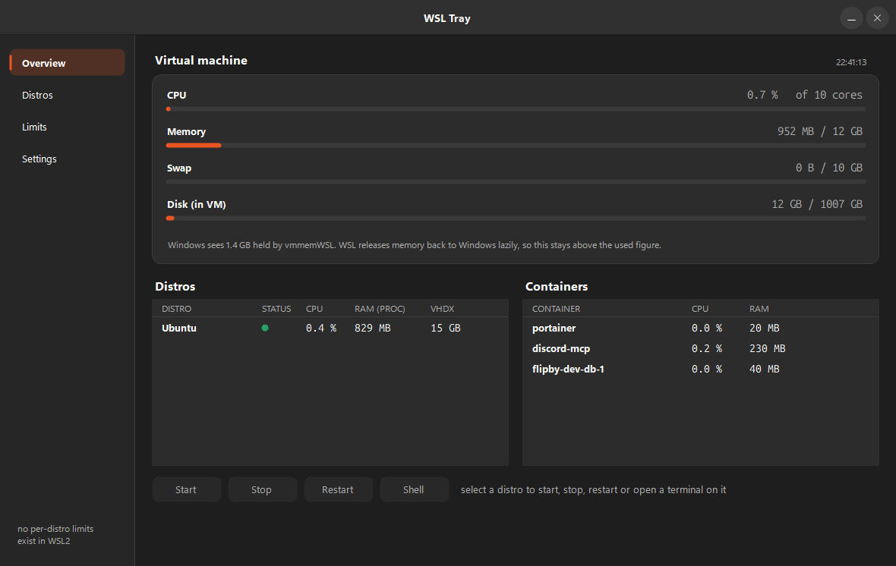
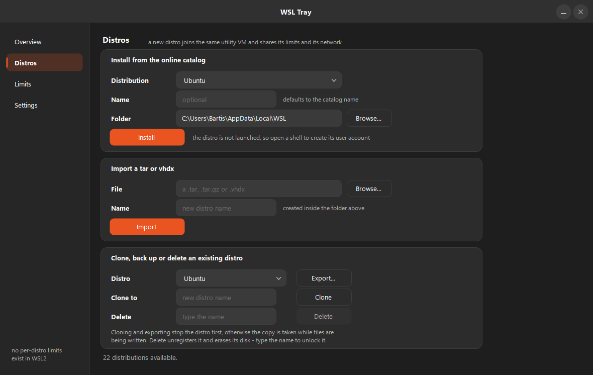

# wsl-tray

A Windows tray tool that shows what WSL2 is actually consuming, caps it, and lets you
start, stop and restart distros without touching a terminal.





## What it does

- **Tray icon as a gauge** - the bar fills and changes color with VM CPU load.
  Hovering shows CPU, RAM and used memory. A flat line means the VM is shut down.
- **Overview** - CPU, memory, swap and in-VM disk for the WSL2 VM, every distro with
  its own usage, and every Docker container.
- **Start / Stop / Restart / Shell** per distro, straight from the Overview. Shell opens
  a real terminal in the distro's Linux home, in Windows Terminal where it is installed.
- **Distros** - install one from the online catalog, import a `.tar` or `.vhdx`, clone an
  existing distro, export one as a backup, or delete one. Deleting is unlocked by typing
  the distro's name, because `wsl --unregister` erases the disk with no recycle bin.
- **VM limits** - edit `.wslconfig` safely, with a restart that verifies the VM comes
  back up and rolls the change back automatically if it does not.

## The one thing to understand about WSL2

**There is no such thing as "several WSL2 VMs".** Every distro runs inside one shared
utility VM with one shared kernel, separated only by namespaces. So:

- `.wslconfig` limits are **global**. Per-distro CPU/RAM limits do not exist in WSL2,
  and no tool can add them.
- Per-distro usage here comes from each distro's own PID namespace. RAM is a sum of
  process RSS, which double-counts shared pages - a useful ranking, not an exact figure.
- A distro you create here **joins that same VM**: same kernel, same memory budget, and
  the same network namespace. Two distros publishing the same port collide, and each
  runs its own `dockerd` with its own containers.
- CPU **cannot** be measured from Windows: `vmmemWSL` is a minimal process with no CPU
  time and no performance counter. All CPU numbers come from `/proc/stat` inside the VM.

## Safe by construction: the memory unit trap

A bare number in `.wslconfig` is read as **bytes**. `memory=10` means ten bytes, and
WSL then refuses to create the VM at all:

```
Wsl/Service/CreateInstance/CreateVm/E_UNEXPECTED
```

Every distro stays dead until the file is fixed by hand. This tool prevents that in
three layers:

1. The size fields are a number plus a unit toggle - the unit cannot be omitted.
2. Values are validated before writing: no bare numbers, nothing below 512MB, nothing
   above the machine's physical RAM, no more processors than the machine has cores.
3. After the restart the VM is actually started again. If it refuses to boot, the
   previous `.wslconfig` is restored automatically and the VM is brought back up.

## Requirements

- **Windows 10 1903 (build 18362) or newer, x64.** That is WSL2's own minimum; .NET 10
  itself would go back to Windows 10 1607. On ARM64 the .exe runs under x64 emulation -
  it works, but a native build needs a second RID.
- **WSL as an app, not the old inbox component.** `wsl --version` has to answer. The
  Distros view uses `wsl --list --online`, `--install --name`, `--import --vhd` and
  `--cd`, which the inbox WSL of older Windows 10 builds does not have. Everything else
  (usage, limits, start/stop) works on any WSL2.
- **No .NET install.** The published .exe is self-contained: it carries the runtime,
  which is why it is ~49 MB.
- **No admin rights** for the tool itself. It writes `%APPDATA%\wsl-tray\config.json`,
  `%USERPROFILE%\.wslconfig` and, only if autostart is enabled, one `HKCU` Run value.
  Installing WSL in the first place does need admin; adding a distro to an existing WSL
  does not.
- Docker is optional. Without it the Containers list simply stays empty.

## Install

There is no installer. Copy `wsl-tray.exe` anywhere and start it - that is the whole
setup. It is unsigned, so if the file was downloaded rather than copied, Windows
SmartScreen shows "Windows protected your PC" once: *More info* then *Run anyway*, or
clear the mark of the web with `Unblock-File .\wsl-tray.exe`.

## Build

```powershell
dotnet build
dotnet publish -c Release -o publish   # single self-contained .exe (~49 MB)
```

## Run

The first launch opens the window, because a tray icon appearing with no explanation is
not a first run. After that it lives in the tray: one click opens the window, closing
the window leaves it running, and Exit in the tray menu quits it.

```powershell
wsl-tray.exe                     # tray app
wsl-tray.exe --window            # tray app with the window already open
wsl-tray.exe --probe             # print one live sample and exit (diagnostics)
wsl-tray.exe --selftest          # parser, validation and config-rewriter checks
wsl-tray.exe --selftest --with-vm  # ALSO restarts the real VM to prove the rollback
```

`--with-vm` is destructive on purpose: it restarts the VM several times, so every
container stops and restarts. It never runs unless asked for explicitly.

## Portable use

Put a `config.json` next to the .exe and it is used instead of
`%APPDATA%\wsl-tray\config.json`. An empty `{}` is enough to claim portable mode.
That makes the tool a copy-and-run on any PC, USB stick included.

## Autostart and Start menu

Two options in Settings, both working on the same installed copy:

- **Start with Windows** (also in the tray menu) registers the copy under
  `HKCU\Software\Microsoft\Windows\CurrentVersion\Run`.
- **Show in Start menu** writes `WSL Tray.lnk` into your per-user Start menu, so typing
  "WSL Tray" into Windows search finds it.

Enabling either one copies the .exe to `%APPDATA%\wsl-tray\wsl-tray.exe` first and points
at **that copy**, so the file you downloaded is free to move or delete afterwards.
Starting a newer build by hand refreshes the copy, so both always run the version you
last used. Turning an option off removes only its entry; the copy stays until you delete
the folder yourself.

Portable mode and autostart do not mix: the copy sits next to `%APPDATA%\wsl-tray\config.json`
and reads that, not the `config.json` on your stick.

## Note on keep-alive scripts

If you run a keep-alive (a script holding a process open so WSL does not idle-terminate
your distro), **Stop will not stick** - the script starts the distro again within
seconds. The tool detects a keep-alive in your Startup folder and says so after a stop.

See [docs/overview.md](docs/overview.md) for architecture and gotchas.
